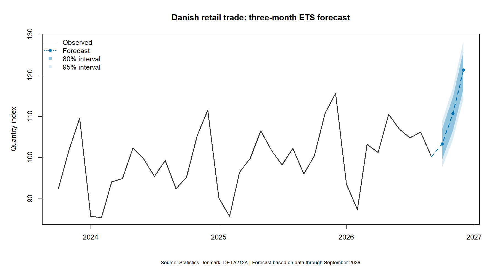
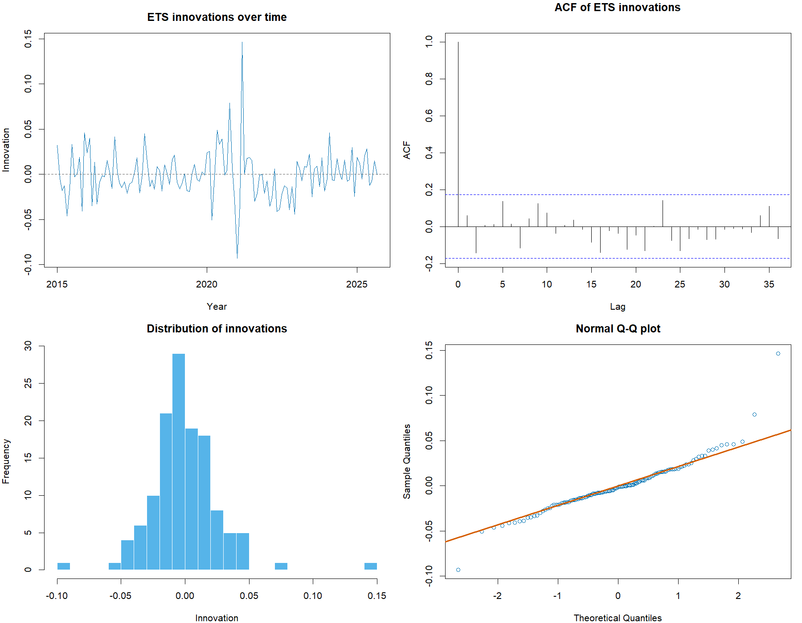

# Danish Retail Forecast

Can time series models improve on a simple seasonal forecast of Danish retail activity?

This project uses public data from Statistics Denmark to analyse monthly retail patterns, compare five forecasting methods, and produce a three-month forecast.

## Forecast



Forecast origin: September 2026. Forecast period: October–December 2026.

| Month | Estimated year-on-year change |
|---|---:|
| October 2026 | +2.86% |
| November 2026 | −0.12% |
| December 2026 | +4.94% |

These are model estimates, not observed changes. The chart shows the quantity index and model-based 80% and 95% prediction intervals.

## Data

Source: [Statistics Denmark, StatBank table DETA212A](https://www.statbank.dk/DETA212A).

The analysis uses 141 monthly observations from January 2015 to September 2026:

- Industry: total retail trade, G47.
- Measure: quantity index, adjusted for price changes.
- Seasonal adjustment: none; seasonal patterns are modelled explicitly.

The import script downloads data through the StatBank API and saves the original CSV and table metadata.

## Methods

The exploratory analysis includes time plots, seasonal subseries plots and STL decomposition.

Five forecasting methods are compared:

- Seasonal naïve
- Random walk with drift
- ETS
- Seasonal ARIMA
- Linear regression with trend and monthly seasonal effects

ETS and ARIMA specifications are selected automatically within each training window. The evaluation therefore compares forecasting procedures rather than one fixed specification.

## Evaluation design

The first 129 observations are used for model development. The final 12 months, October 2025–September 2026, are reserved for the final evaluation.

### Cross-validation

- Expanding training windows, starting with 72 months.
- Training window extended by one month at each step.
- 55 forecast origins.
- Forecast horizons of 1, 2 and 3 months.
- 165 evaluated predictions per method.

### Final evaluation

The selected ETS procedure is compared with Seasonal naïve using 10 expanding-window forecast origins in the reserved period.

Each origin produces forecasts for the following three months. Earlier test observations become training data only after they would have been observed.

## Results

### Cross-validation

| Method | RMSE | MAE | MAPE |
|---|---:|---:|---:|
| ETS | 3.75 | 2.66 | 2.69% |
| ARIMA | 4.26 | 2.92 | 3.01% |
| Regression | 4.54 | 3.52 | 3.62% |
| Seasonal naïve | 5.32 | 4.04 | 4.15% |
| Drift | 11.6 | 8.95 | 9.39% |

ETS had the lowest errors at all three forecast horizons.

### Final evaluation

| Method | RMSE | MAE | MAPE |
|---|---:|---:|---:|
| ETS | 2.49 | 2.03 | 1.94% |
| Seasonal naïve | 4.59 | 4.25 | 4.07% |

ETS reduced overall RMSE by approximately 45.8% relative to Seasonal naïve, calculated from the rounded values above.

RMSE and MAE are expressed in index points. MAPE is the mean absolute percentage error, not an accuracy percentage.

## Model diagnostics

The ETS model fitted to the development data was ETS(M,A,A): multiplicative errors, additive trend and additive seasonality.

Its innovations had a mean close to zero. A Ljung–Box test through lag 24, with fitdf = 0, returned p = 0.4127. This did not detect significant autocorrelation at those lags.

The Q-Q plot showed departures in the tails, and several large innovations remained.



In the final evaluation, ETS prediction intervals achieved the following coverage at each of the three horizons:

- Nominal 80% intervals: 9 of 10 observations, or 90%.
- Nominal 95% intervals: 10 of 10 observations, or 100%.

This small sample does not establish that the intervals are well calibrated.

## Reproduce the analysis

Open `danish-retail-forecast.Rproj` in RStudio.

Run the scripts from the project root in this order:

```r
source("R/01_import_data.R")
source("R/02_prepare_data.R")
source("R/03_explore_data.R")
source("R/04_evaluate_models.R")
source("R/05_model_diagnostics.R")
source("R/06_final_test.R")
source("R/07_forecast.R")
```

The import and evaluation scripts install their required packages if missing. Internet access is required for package installation and API downloads.

The import retrieves the latest available data. Future downloads or package versions may change the results. To work with the committed data snapshot, start with script 02.

## Repository contents

| Folder | Contents |
|---|---|
| `R/` | Import, preparation, exploration, evaluation and forecasting scripts |
| `data/raw/` | Original data and metadata |
| `data/processed/` | Prepared monthly series and evaluation split |
| `outputs/figures/` | Exploration, diagnostics and forecast charts |
| `outputs/tables/` | Evaluation scores, predictions and model reports |
| `outputs/models/` | Saved fitted models |

## Limitations

- Evaluation uses the downloaded data vintage, which may contain revisions unavailable at historical forecast dates.
- Initial exploratory charts included the full series before the final test period was reserved.
- Forecast windows overlap, so evaluated errors are not independent.
- The final evaluation contains only 10 predictions per horizon.
- Calendar effects, external economic indicators and intervention variables are not explicitly included.
- Prediction intervals depend on model assumptions and do not guarantee coverage.
- October–December 2026 forecasts use observations available through September 2026; they are not based on data through the publication date.
- Findings describe predictive performance, not causal effects.

## Author

Maria Cristiana Maxim

Data analysis and forecasting in R.

This is an independent portfolio project and is not an official Statistics Denmark forecast.